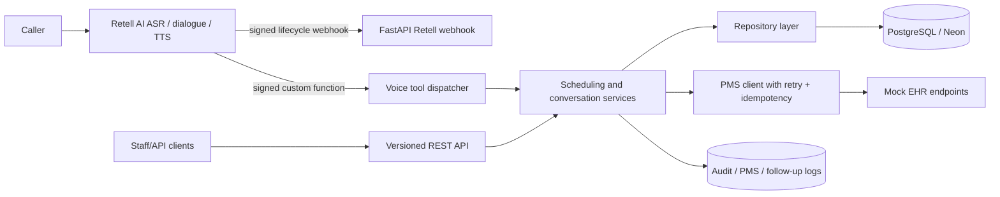

# Arogya Clinic Voice AI Receptionist

Production-oriented FastAPI backend for a multilingual Retell AI receptionist serving a multi-branch clinic. It books, reschedules, and cancels against live PostgreSQL slot data; recognizes returning callers; resumes dropped calls; and creates staff follow-up work for human or clinical escalation.

## Architecture



The API, voice tools, and EHR adapter share business services. This prevents the voice path from bypassing identity or scheduling rules. Availability is never cached. Booking locks the selected slot with `SELECT ... FOR UPDATE`; the slot uniqueness constraints and one-to-one appointment/slot constraint provide database-level defense in depth.

## Repository layout

```text
app/
  api/             REST, mock EHR, Retell, and conversation routes
  core/            environment, structured logging, errors, signature security
  db/              SQLAlchemy models and async session factory
  services/        scheduling, PMS, callback/state, and escalation logic
  voice/           multilingual prompt, Retell tool schemas and dispatcher
alembic/           database migration environment and initial migration
scripts/seed.py    idempotent clinic/schedule/slot seed
tests/             async unit and API integration tests
evaluation/        scenario catalog, JSONL scorer, sample observations/report
```

## Database schema

The schema includes `patients`, `doctors`, `departments`, `branches`, `doctor_schedules`, `appointment_slots`, `appointments`, `call_sessions`, `conversation_states`, `callback_history`, `pms_logs`, `audit_logs`, and `follow_up_tasks`.

Important invariants:

- One slot per doctor, branch, and start time.
- At most one appointment per slot.
- Indexed live searches on branch, doctor, time, and booked state.
- Multiple patients may intentionally share a phone number; `(phone, full_name)` is indexed, not unique.
- Conversation state is versioned for optimistic concurrency and stored independently of the LLM context.
- PMS requests are unique by `(idempotency_key, operation)`.
- UTC timestamps are stored in PostgreSQL; branch-local rendering uses IANA timezones.

The initial seed creates Arogya Central (Connaught Place), Arogya South (Saket), Cardiology, General Medicine, Pediatrics, three realistic doctors, six-day schedules, lunch breaks, and 45 days of appointment slots.

## Local startup

Requirements: Docker Desktop and Docker Compose.

```bash
cp .env.example .env
# Set RETELL_WEBHOOK_SECRET to the designated Retell webhook API key.
docker compose up --build
```

Migrations and the idempotent seed run before Uvicorn starts. OpenAPI is at `http://localhost:8000/docs`; readiness is `GET /api/v1/health`.

To run without Docker:

```bash
python -m venv .venv
source .venv/bin/activate  # Windows PowerShell: .venv\Scripts\Activate.ps1
pip install -e ".[test]"
alembic upgrade head
python -m scripts.seed
uvicorn app.main:app --reload
```

## Environment variables

| Variable | Required | Purpose |
|---|---:|---|
| `DATABASE_URL` | yes | Async SQLAlchemy URL; Neon must use `postgresql+asyncpg://` and TLS parameters as supplied by Neon |
| `RETELL_WEBHOOK_SECRET` | yes | Retell designated webhook key used for timestamped HMAC verification |
| `RETELL_API_KEY` | deployment | Retell management API credential; never expose to callers |
| `OPENAI_API_KEY` | deployment | OpenAI credential when the Retell LLM is connected to the project account |
| `OPENAI_MODEL` | no | Defaults to `gpt-4.1` |
| `PUBLIC_BASE_URL` | yes | Public HTTPS origin registered in Retell |
| `CLINIC_TIMEZONE` | no | Default `Asia/Kolkata` |
| `BOOKING_BUFFER_MINUTES` | no | Prevents last-minute bookings; default 15 |
| `PMS_BASE_URL` | yes | PMS origin; compose points this at the API's mock EHR |
| `PMS_FAILURE_RATE` | no | Mock-only controlled failure rate, 0–1 |
| `LOG_LEVEL` | no | Structured JSON log level |

Never commit `.env`. Use Railway variables/secrets and a Neon pooled connection in production.

## API overview

All clinic routes use `/api/v1`:

| Method | Path | Behavior |
|---|---|---|
| GET | `/health` | Database-backed health check |
| POST / GET | `/patients`, `/patients/{id}` | Create/read patients |
| GET | `/patients/lookup/phone?phone=...` | Return all phone matches and appointment history |
| POST / GET | `/branches`, `/branches` | Create/list active branches |
| POST / GET | `/doctors`, `/doctors?department_id=...` | Create/filter doctors |
| POST | `/availability` | Fresh earliest-slot search across branches/doctors/department |
| POST | `/appointments` | Verified-name, row-locked booking plus PMS confirmation |
| POST | `/appointments/{id}/reschedule` | Atomically releases old slot and locks new slot |
| POST | `/appointments/{id}/cancel` | Idempotent cancellation and slot release |
| GET / PATCH | `/conversations/{session_id}/state` | Durable versioned voice state |
| GET | `/conversations/callbacks/{phone}` | Recoverable dropped-call lookup |

Mock PMS endpoints are `POST /ehr/book`, `/ehr/reschedule`, and `/ehr/cancel`. They require an `Idempotency-Key` header, persist request/confirmation logs, support `PMS_FAILURE_RATE`, and return a write-back reference. The real PMS adapter retries transport and 5xx errors three times with exponential backoff and never lets the assistant claim success without write-back confirmation.

## Retell setup and tool flow

1. Create a Retell agent using an OpenAI GPT-4.1-backed Retell LLM.
2. Copy the prompt and tool definitions returned by `GET /retell/llm-config` into the agent or provision them through Retell's management API.
3. Register `https://<host>/retell/webhook` for `call_started`, `call_ended`, and optionally `transcript_updated`.
4. Configure each custom function to call `POST https://<host>/retell/functions` with the standard `{name, call, args}` payload.
5. Set the designated webhook API key as `RETELL_WEBHOOK_SECRET`.
6. Enable multilingual language handling, responsive interruptions, and the desired Hindi/English voice in Retell.

Both endpoints verify Retell's current `v=<milliseconds>,d=<digest>` HMAC format against the raw body and reject timestamps outside five minutes. Lifecycle webhooks have a 10-second delivery window and retries, so handlers are idempotent by Retell call ID. See the official [webhook security](https://docs.retellai.com/features/secure-webhook), [webhook events](https://docs.retellai.com/features/webhook-overview), and [custom function contract](https://docs.retellai.com/build/conversation-flow/custom-function).

Tool flow:

```mermaid
sequenceDiagram
    participant C as Caller
    participant R as Retell / GPT-4.1
    participant A as FastAPI
    participant D as PostgreSQL
    participant P as PMS
    C->>R: English / Hindi / mixed request
    R->>A: lookup_patient(phone)
    A->>D: all phone matches + history
    A-->>R: identities; disambiguation flag
    R->>A: find_availability(criteria)
    A->>D: fresh ordered slot query
    A-->>R: live slot options
    R->>A: book_appointment(full name, slot, key)
    A->>D: lock and revalidate slot
    A->>P: idempotent write-back with retry
    P-->>A: confirmation reference
    A->>D: commit appointment, audit, PMS log
    A-->>R: confirmed
    R-->>C: one concise read-back
```

## Prompt and identity design

The system prompt mirrors the caller's current English, Hindi, or Hinglish without translation tables. It minimizes turns by reusing persisted facts and asking only for missing fields. It requires tools for live data, full name before booking, one final read-back, and explicit disambiguation when a phone number maps to several patients. Clinical advice is prohibited. Human requests and clinical concerns create `follow_up_tasks`; the assistant states that staff will follow up and never invents an immediate transfer.

On a callback within 24 hours, the latest active/disconnected call's intent, collected fields, missing fields, patient association, language, and last message are copied into a new session and linked in `callback_history`. This survives process restarts and does not rely on model memory.

## Testing

```bash
pip install -e ".[test]"
pytest -p no:cacheprovider
```

Tests use SQLite only as an isolated service/API test store. Release validation should additionally run migrations and concurrency tests against PostgreSQL 16 because SQLite does not implement PostgreSQL row locks.

Current automated coverage includes API health/patient creation, patient-name identity, double-book prevention, dropped-call state recovery, and Retell signature/replay protection.

## Evaluation

`evaluation/scenarios.json` covers booking, rescheduling, cancellation, returning callers, callbacks, dropped calls, cross-branch search, English, Hindi, and mixed language. Export each observed call as one JSON object per line using the format documented in `evaluation/run.py`, then run:

```bash
python -m evaluation.run evaluation/sample-runs.jsonl --output evaluation/report.json
```

Reports contain success rate, booking accuracy, average total/tool/LLM/ASR/TTS latency, turns to completion, redundant questions, and failed tool calls. The committed sample input demonstrates the format; its values are illustrative, not production benchmarks. For real calls, take ASR/TTS/LLM timings from Retell telemetry and tool timings from `X-Process-Time-Ms` plus structured logs.

### Latency analysis

The critical confirmation path is one database lock/query plus one PMS request. Keep API and Neon regions close, use a pooled Neon connection, and set the PMS timeout below Retell's function timeout. Monitor p50/p95/p99 separately for ASR, LLM first token, tool, PMS, and TTS. A high tool p95 generally indicates database/PMS locality; high turns with normal tool latency indicates prompt or entity-collection regressions.

## Railway deployment

1. Create a Railway project and Neon PostgreSQL database.
2. Deploy this repository; `railway.json` selects the Dockerfile, runs migrations/seed, and configures the health check.
3. Set every production environment variable, including the public HTTPS URL and webhook key.
4. Change `PMS_BASE_URL` from the mock endpoint to the clinic's private PMS adapter.
5. Register Retell webhook/function URLs only after the health check passes.
6. Run PostgreSQL integration tests, a Retell test call in each language, and the full evaluation cohort before routing the clinic number.

Use one migration job during multi-replica rollout rather than allowing every replica to migrate concurrently. Restrict `/ehr/*` and management routes to the private network/API gateway, enforce TLS, add clinic SSO/RBAC at the gateway, redact PHI in infrastructure logs, configure backups/PITR, data retention, consent, and access review according to the clinic's legal jurisdiction.

## Operational behavior

- JSON logs carry request IDs without logging raw phone numbers or transcripts by default.
- API errors use stable domain codes and avoid stack details.
- Failed PMS confirmation rolls back the scheduling transaction and produces no spoken confirmation.
- Audit events cover scheduling changes and escalation tasks.
- Webhook replay protection is five minutes; call IDs and idempotency keys make retries safe.
- Health checks validate database connectivity rather than process liveness alone.

## Known limitations

- The included EHR is intentionally a mock contract. A real deployment needs the clinic vendor's authentication, field mapping, reconciliation worker, and sandbox certification.
- Retell agent/phone provisioning remains an account-level deployment action because credentials and purchased numbers cannot safely be committed.
- Staff authentication/RBAC, consent recording, jurisdiction-specific retention, encryption key management, and incident-response controls depend on the clinic's identity/cloud environment and must be added at the gateway/platform layer before handling protected health information.
- No automated test can establish clinical safety. The assistant is constrained from advice, but the clinic must review prompts, emergency wording, escalation SLAs, and sampled calls.
- The initial migration uses SQLAlchemy metadata for a clean initial install. Subsequent schema changes should be explicit reviewed Alembic revisions.

## Future improvements

- Clinic-vendor PMS adapter with transactional outbox, asynchronous reconciliation, and dead-letter operations.
- Staff dashboard for follow-up queues, audit search, and callback SLAs.
- PostgreSQL concurrency/load suite and chaos testing for PMS timeouts.
- Retell management API provisioning with versioned agent releases and canary traffic.
- Automated PII redaction, configurable retention, consent workflows, and regional data residency.
- Production telemetry export to OpenTelemetry with call-correlated p95/p99 dashboards and alerts.
